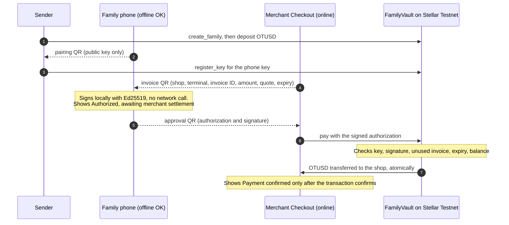

# OpenTab Global

**Family support that works at the corner shop, even when the phone has no data.**

**Live app:** https://opentabglobal.vercel.app/ · **Network:** Stellar Testnet · **Demo video:** [placeholder, see below](#demo-video)

> **Stellar Testnet prototype. Not a production banking product.** Payments settle in **OpenTab Demo USD (`OTUSD`)**, a
> Testnet token with no monetary value. It is **not USDC**. Exchange rates are **illustrative**, not live quotes. No bank
> payouts exist. The contracts are unaudited. OpenTab is not a licensed financial service.

Built for the **Blockchain Innovation Challenge powered by Stellar** (University of Waterloo Velocity), Problem Space 3:
Transnational Households.

## What we built

OpenTab Global lets a relative abroad fund a shared family spending balance on Stellar. A family member back home spends it
at participating local shops by approving the shop's QR invoice on their phone, **with no mobile data**. The shop's
terminal, which is online, submits the signed approval to a Soroban smart contract. The contract checks the approval and
pays the shop in one atomic on-chain transaction.

What is deployed and working on Stellar Testnet today:

- **FamilyVault**, a Soroban contract holding per-family balances. It also keeps a registry of each family's phone keys and
  checks Ed25519-signed, single-use payment authorizations.
- **A Next.js progressive web app** with three working roles: Sender, Family wallet and Merchant Checkout.
- **Confirmed on-chain payments**: QR-signed purchases at two different shops, all spending from the same family balance.
  The contract rejected an attempt to replay one of those approvals.

## The problem

Families who send money home need reliable, low-cost ways for that money to pay for everyday essentials. Today a
remittance often has to be collected as cash at a pickup counter, which costs time and fees, and cash is hard to earmark
for groceries or medicine. Many recipients own a phone but have patchy, expensive or no mobile data. Small local shops
often extend informal credit and carry that risk themselves.

## Our solution

Family-funded merchant payments using Stellar:

- **One shared family balance on chain.** The sender funds it. Only the family's registered phones can spend it, and only
  at merchants the family member approves, one exact amount at a time.
- **The family member's phone does not need connectivity.** It signs an approval for one exact invoice: this shop, this
  amount, this invoice ID, before this expiry. The shop's terminal carries it to the chain.
- **The shop is paid by the contract, not by trust.** The merchant sees **Payment confirmed** only after the Stellar
  transaction has confirmed.

## How it works

**Sender → Family member → Merchant → Stellar settlement**



1. **Sender** creates a family and deposits OTUSD. The sender then scans the family member's pairing QR, which contains
   only a public key, and registers that key on chain for the family.
2. **Merchant** enters a local price, for example `MXN 20.00`. Checkout converts it at an illustrative rate to an exact
   OTUSD amount and shows an invoice QR. The invoice has a random 32-byte invoice ID and a 15-minute expiry.
3. **Family member** scans the invoice and reviews the shop, local price, exact token amount and expiry. They then approve
   it on their phone, which can be fully offline.
4. **Merchant** scans the approval QR and submits it to FamilyVault. On success the tokens move from the family balance
   to the shop's Stellar account in the same transaction.

## Offline payments: approval is not settlement

The family member's phone signs a **340-byte canonical payment message** with an Ed25519 key that lives only in that
browser. The message binds:

- the network, contract, token and family;
- the merchant and terminal;
- the invoice ID, the amount, the quote hash and the expiry.

Signing makes no network request. Browser tests confirm that the phone sends zero API requests while it signs.

**A signed approval is not yet a settled transaction.** An offline phone cannot know whether:

- the family balance is still sufficient;
- its key has been revoked;
- that invoice has already been paid.

So the phone always says *"Authorized. Awaiting merchant settlement. This is not a payment yet."* The FamilyVault contract
makes the final decision when the merchant submits the approval:

| Check enforced on chain | Effect |
|---|---|
| Key registered for this family and not revoked | Lost or replaced phones can be revoked by the sender |
| Ed25519 signature over every invoice field | A changed amount, shop or terminal fails verification |
| Invoice ID never used before | Replaying an approval is rejected (`InvoiceUsed`) |
| Not past the expiry | Old approvals cannot be collected later |
| Enough family balance | Overspending fails, and so do concurrent spends that would together overspend |

The merchant screen shows **Payment confirmed** only after the transaction confirms on Stellar. If a submission times
out, the app shows a pending or unknown state. It then reconciles by transaction hash and invoice status, so a timeout
never turns into a second charge.

**Scope today:** the customer can be offline and the merchant is online. A second contract for payments where *both*
sides are offline is in `contracts/offline_channel`. It holds funds reserved for one named shop and accepts cumulative
signed tickets. It has 24 local tests but is **not deployed and not used by the app**.

## Stellar integration

All values below come from the repository configuration (`.env.example`, `submission/RELEASE_LINKS.md`). The token's name,
symbol and decimals, and the vault's configured token, were read back from Testnet on 2026-11-13.

| Item | Value |
|---|---|
| Network | Stellar Testnet (`Test SDF Network ; September 2015`), RPC `https://soroban-testnet.stellar.org` |
| **FamilyVault contract** | [`CAUCH3MNJGIYDLOY3OB3YCKRCBWWY3J3HZB5QCHPJXUWXBMK5IABYLGW`](https://stellar.expert/explorer/testnet/contract/CAUCH3MNJGIYDLOY3OB3YCKRCBWWY3J3HZB5QCHPJXUWXBMK5IABYLGW) |
| FamilyVault WASM hash | `e3aac2d991c2c061c134100eefee86db7fbb006b553a1a37d650bc6c8db11190` |
| Deploy transaction | [`86f91a10…ea5949`](https://stellar.expert/explorer/testnet/tx/86f91a10b0203358b1f58c95411c3f811af0d868b68ac96c885c86fc07ea5949) |
| **Settlement token** | OpenTab Demo USD, code `OTUSD`, 7 decimals, Testnet only, no value, **not USDC** |
| Token issuer | `GCZDLLF3OYZVD5HDKN3DRP475ICCKMRN6Q3PHNMTILABZWSGWPS5RCAY` |
| Token Stellar Asset Contract | [`CC6JPD3NL3ZJMWT2JG246ISOG5QB2N72BG77KPVC3OCDEYUHK2TEPL73`](https://stellar.expert/explorer/testnet/contract/CC6JPD3NL3ZJMWT2JG246ISOG5QB2N72BG77KPVC3OCDEYUHK2TEPL73) |
| Demo shops | Tienda Rosa `GCDSS6VQP6GGTV6K2J6FMG2TQN2G2EG37TSQ5UYQK547ODDYGNPPRWN4`, Farmacia Luz `GBIIBDC4PM237AP57I42FO4GGKDUC53ZAQXIOOALVFBNCOLDULKJGEAI` |
| Demo sender | `GBC7D7XKWZZYJ7BRMZGBP44ASRG2ATAKKNI227XA5C4HBHTPRUN5F235` |

**Contract interface** (`contracts/family_vault/src/lib.rs`):

- Setup and funding: `create_family`, `deposit`, `withdraw`, `extend_family_ttl`.
- Phone keys: `register_key`, `revoke_key`.
- Payments: `pay`.
- Read-only: `get_family`, `balance`, `is_key_active`, `is_invoice_used`, `payment_message`, `config`.

The phone's key **does not need a Stellar account or XLM**. Soroban verifies the Ed25519 signature natively.

**On-chain evidence** (Stellar Expert, Testnet):

| Event | Transaction |
|---|---|
| QR-signed payment, MXN 100.00 → 5.4288817 OTUSD to Tienda Rosa | [`0b8d72ed…bbb05f`](https://stellar.expert/explorer/testnet/tx/0b8d72ed8e267ca31f2fe7179f5afbdcb7586e2c887c18a90a7d2c3b63bbb05f) |
| Same family balance spent at a second shop (Farmacia Luz) | [`009cc536…80e5f3`](https://stellar.expert/explorer/testnet/tx/009cc536cc3d8c88445b4a07b5d6de0189b843544c0d3ce9a57bddf87280e5f3) |
| Browser payment, family phone offline while signing | [`e42405a8…8811d4`](https://stellar.expert/explorer/testnet/tx/e42405a85a595d7a9bc347d1f4fa09b2364a76043984746e6ed9a7f8e98811d4) |
| Replay of the first approval | Rejected by the contract with `InvoiceUsed`; shop balance unchanged |

The full evidence log, with every hash and how it was observed, is in
[`submission/RELEASE_LINKS.md`](submission/RELEASE_LINKS.md). It was written on 2026-11-12, before the app was deployed,
so its repository and Vercel rows still read "TBD". You can check the chain yourself with read-only calls, which submit no
transaction:

```bash
stellar contract invoke --id CAUCH3MNJGIYDLOY3OB3YCKRCBWWY3J3HZB5QCHPJXUWXBMK5IABYLGW --network testnet \
  --source-account <any funded Testnet account> --send=no -- get_family --family_id 7
```

## Architecture and technology stack

```text
 Phone / browser (PWA)                   Next.js server (Vercel)                  Stellar Testnet
 ─────────────────────                   ───────────────────────                  ───────────────
 Family wallet ─ key in this browser,    /api/sender/*   (guarded) ────── sign ─▶ FamilyVault (Soroban)
   signs invoices offline                /api/merchant/pay (guarded) ───── sign ─▶   └─ OTUSD Stellar Asset
 Merchant Checkout ─ invoice / scan ──▶  /api/family, /api/merchant,                    Contract transfer
 Sender ─ fund, pair phones ──────────▶    /api/tx, /api/invoice (public reads) ─▶ Soroban RPC (simulate, events)
 Product Mode ─ read-only views ──────▶  Testnet demo signers in server-only env vars
```

- **Contracts:** Rust, `soroban-sdk` 29.0.1, built for `wasm32v1-none`.
- **Shared protocol** (`packages/shared`): the canonical message encoder, QR payload formats, integer FX math and Ed25519
  signing (`@noble/curves`). The Rust tests verify the same test vector, so the TypeScript and Rust encoders cannot
  silently drift apart.
- **Web app** (`apps/web`):
  - Next.js 15.5 (App Router), React 19.1, TypeScript 5.9 and `@stellar/stellar-sdk` 17.4.
  - QR codes are drawn with `qrcode` and scanned with `jsQR` through the camera.
  - A service worker keeps the app shell available offline, and the app can be installed as a PWA.
- **Server role:** in this demo, the sender and the two shops are Testnet accounts operated by the server. Their keys live
  only in server-side environment variables. The family member's key never leaves their browser.
- **Tests:** Rust unit tests, Vitest, and Playwright with Desktop Chrome and an emulated iPhone 13 on WebKit.
- **Hosting:** Vercel. The root directory is `apps/web`.

```text
contracts/family_vault/      Deployed Soroban contract + 34 tests
contracts/offline_channel/   Both-offline contract (Mode B) + 24 tests, NOT deployed
packages/shared/             Canonical message encoder, signing, QR payloads, FX math (20 tests) + test vector
apps/web/app/demo/           Demo Mode: judge intro, live activity, Sender / Family / Shop
apps/web/app/{sender,family,shop}/  Working payment screens (also served under /demo/*)
apps/web/app/{home,dashboard,wallet,business,onboarding}/  Product Mode (read-only)
apps/web/app/api/            Server routes: access control, Testnet relay, public reads
apps/web/lib/                Chain client, guards, config (23 tests)
tests/e2e/                   Playwright browser tests
scripts/                     Live API and security checks, test-vector generator, print renderer
docs/                        Architecture, decisions, build log, system map
submission/                  Overview, pitch, demo script, trifold sources, evidence
archive/legacy_opentab_starter/  Original single-shop prototype (reference only)
```

More detail: [`docs/SYSTEM_MAP.md`](docs/SYSTEM_MAP.md), [`docs/APPROVED_ARCHITECTURE.md`](docs/APPROVED_ARCHITECTURE.md),
[`docs/DECISIONS.md`](docs/DECISIONS.md) and [`docs/BUILD_LOG.md`](docs/BUILD_LOG.md).

## Live application

**https://opentabglobal.vercel.app/** opens Demo Mode at `/demo`. That page introduces the demo for judges and has a
live activity panel. The panel lists confirmed payments for demo Family #7 read from the contract, refreshing every 20
seconds.

- **Family wallet** (`/demo/family`) is open to everyone.
- **Sender** (`/demo/sender`) and **Merchant Checkout** (`/demo/shop`) need **no access code**. Anyone can add funds to
  demo Family #7 (up to 50 OTUSD per deposit), pair a phone with it and settle purchases. These screens spend from
  server-held Testnet accounts, so creating families, revoking devices and acting on other families stay operator-only.
- To try a full purchase, use two browser windows or two devices: one as Merchant Checkout and one as the Family wallet.
  Turn the family device's data off before approving.

## Demo Mode vs Product Mode

A switch at the top of every page moves between the two modes.

| | **Demo Mode** (primary for judging) | **Product Mode** (consumer UI preview) |
|---|---|---|
| Routes | `/demo`, `/demo/sender`, `/demo/family`, `/demo/shop` (also `/sender`, `/family`, `/shop`) | `/home`, `/onboarding`, `/dashboard`, `/wallet`, `/business` |
| What it is | The real working technical experience: funding, phone pairing, offline approval, on-chain settlement, receipts | The consumer-facing design of the same product |
| Data | Real Stellar Testnet transactions | **Read-only.** Family #7's balance and confirmed purchases are read live from FamilyVault where supported |
| Actions | Sign and submit real Testnet transactions | Buttons such as Add money, Scan to Pay and Open Merchant Checkout open the matching Demo Mode screen |
| Accounts | None. Sender and Shop are open for demo Family #7 | None. Onboarding only records a role choice in a browser cookie; no email, and not payment authorization |

## Setup and running locally

**Requirements:**

- Node.js 22 or newer (tested on 22.19) and npm.
- For the contracts only: Rust 1.99 with `rustup target add wasm32v1-none`, and Stellar CLI 30.

```bash
git clone https://github.com/GrasshopperD/opentab.git opentab-global
cd opentab-global
npm install
cp .env.example apps/web/.env.local      # Windows PowerShell: copy .env.example apps\web\.env.local
npm run dev                              # http://localhost:3000
```

**Environment variables** (template: [`.env.example`](.env.example); `apps/web/.env.local` is git-ignored):

| Variable | Visibility | Purpose |
|---|---|---|
| `NEXT_PUBLIC_STELLAR_NETWORK`, `NEXT_PUBLIC_STELLAR_NETWORK_PASSPHRASE`, `NEXT_PUBLIC_STELLAR_RPC_URL` | public | Testnet network and RPC |
| `NEXT_PUBLIC_FAMILY_VAULT_CONTRACT_ID`, `NEXT_PUBLIC_TOKEN_CONTRACT_ID`, `NEXT_PUBLIC_TOKEN_CODE`, `NEXT_PUBLIC_TOKEN_LABEL`, `NEXT_PUBLIC_TOKEN_ISSUER` | public | Deployed contract and demo token (prefilled) |
| `NEXT_PUBLIC_MERCHANT_A_ADDRESS`, `NEXT_PUBLIC_MERCHANT_B_ADDRESS` | public | Demo shop accounts (prefilled) |
| `SENDER_SECRET`, `MERCHANT_A_SECRET`, `MERCHANT_B_SECRET` | **server-only** | Testnet signers you provide. Never prefix with `NEXT_PUBLIC_`, never commit |
| `DEMO_ACCESS_CODE` (≥ 8 chars), `DEMO_SESSION_SECRET` (≥ 32 random chars) | **server-only** | Operator-only actions (create family, revoke device, other families). Also the kill switch: if either is missing, every signing endpoint, public ones included, is disabled |
| `NEXT_PUBLIC_DEMO_FAMILY_ID` | public, optional | Existing family shown by the demo (default `7`) |
| `INVITES_ENABLED` | server, optional | Local-only invitation-link pairing preview. Always off on Vercel |

**What works with which keys:**

- **No server keys:** the app runs, but chain reads go through the server's sender account, so screens report
  `NOT_CONFIGURED` instead of showing invented balances.
- **Read-only against the deployed contract:**
  1. Create a funded Testnet account with `stellar keys generate my-sender --network testnet --fund`.
  2. Put its secret (`stellar keys show my-sender`) into `SENDER_SECRET` in `apps/web/.env.local`.
- **Full payment flow:** this needs accounts that hold the test token. OTUSD is issued by the team's Testnet issuer, so
  to run the flow on your own:
  1. Issue your own Testnet asset and deploy its Stellar Asset Contract (`stellar contract asset deploy`).
  2. Add trustlines for your sender and two merchants (`stellar tx new change-trust`), then fund the sender
     (`stellar tx new payment`).
  3. Build and deploy your own FamilyVault:

     ```bash
     stellar contract build
     stellar contract deploy --wasm target/wasm32v1-none/release/family_vault.wasm \
       --source-account <admin identity> --network testnet -- --admin <admin G...> --token <token contract C...>
     ```

  4. Put the new IDs and addresses into the `NEXT_PUBLIC_*` variables.

**Build and test:**

```bash
npm run build                        # production Next.js build
npm run typecheck -w apps/web        # TypeScript
npm test                             # 20 shared protocol tests + 23 web library tests (Vitest)
cargo test --locked                  # 34 FamilyVault + 24 OfflineChannel contract tests
stellar contract build               # WASM into target/wasm32v1-none/release/
```

Browser and API checks run against a running server: `npm run build && npm run start`, or set
`OT_BASE_URL=https://opentabglobal.vercel.app`. The security checks and the operator journeys need `OT_DEMO_CODE` set
to the operator access code:

```bash
npx playwright install chromium webkit
npx playwright test --grep-invert "full journey|preset family, Milk"   # browser suite without on-chain spending
npm run test:security                # 23 access-control, CSRF and input-limit checks (no spending)
```

`npm run test:e2e` (the full browser suite) and `npm run test:api` (the live API journey) **submit real Testnet
transactions** and spend demo tokens.

Last recorded results (2026-11-13, see [`docs/BUILD_LOG.md`](docs/BUILD_LOG.md)):

- Browser suite without spending: 48 passed and 2 skipped.
- Security checks: 23/23.
- Unit tests: 20/20 and 23/23. Contract tests: 34/34 and 24/24.

**Deploying to Vercel:**

1. Import the repository and set the **root directory to `apps/web`**. Keep files outside the root directory included,
   because the app imports `packages/shared`.
2. Add the variables above.
3. Give the server-only signing secrets to **Production only**, not to preview deployments of untrusted branches.

## Security considerations and known limitations

**Security model:**

- **Testnet only.** No real money, no Mainnet deployment, no production provider credentials.
- **No secrets in the repository.** Signing keys, the operator access code and the session secret live only in server environment
  variables. `.env*` files are git-ignored apart from the empty template.
  - Before this repository was made public, its full Git history was checked: every branch and pull-request ref, scanned
    with gitleaks plus checksum-validated Stellar seed detection.
  - The test vector in `packages/shared/vectors/` uses a deliberately public test key (32 bytes of `0x07`). It is not
    registered for any family on chain.
- **Public demo, operator-only administration.** Without a code, visitors can deposit to, pair phones with and pay from
  demo Family #7 only. Creating families, revoking devices, acting on other families and invitations need an operator
  session: the operator access code is exchanged for an HttpOnly, SameSite=Strict session cookie that lasts 8 hours.
  Every state-changing endpoint also:
  - requires a same-origin JSON request;
  - limits the request body to 4 KB;
  - caps deposits at 50 OTUSD;
  - applies per-IP rate limits.
- **Recipient keys stay on the phone.** The Ed25519 key is generated in the browser and stored in `localStorage`. Pairing
  QR codes contain only the public key.
- **The contract is the authority.** The server pre-checks requests only to give clearer error messages.
- **Invitation-link pairing** is a local-only preview and returns 503 on Vercel. Manual QR pairing is the supported flow.

**Known limitations:**

- **Prototype, not a banking product.** It is unaudited, has no licensing, no KYC/KYB, and no fiat on-ramps or off-ramps.
  Exchange rates are illustrative.
- **Browser key storage is not production custody.** There is no key recovery. A production version would need
  non-extractable keys or passkeys.
- **Sender and shops are demo accounts.** They are server-operated Testnet identities, not user wallets.
- **No physical-phone test yet.** Offline signing has been verified only in emulated-offline Chromium and emulated iPhone
  WebKit. Physical airplane-mode testing, PWA installation and camera scanning on a real phone are not yet verified.
- **Both-offline payments (Mode B)** are not deployed. The contract exists with local tests only.
- **Payment history is limited.** It comes from recent Soroban RPC events and covers about the last day.
- **Rate limits are best effort.** They are held in memory per serverless instance, not as a global quota.
- **The open demo family can be emptied by anyone.** Any visitor can pair a phone with Family #7 and spend its balance:
  at the demo shops, or by calling the contract directly, to any account they control. It is refilled from the server's
  demo sender. The tokens have no value, and the team re-issues OTUSD from its Testnet issuer if the demo pool runs low.
- **Known dependency advisory.** `npm audit` reports a PostCSS advisory through Next.js, which processes only our own CSS
  at build time. The fix requires upgrading to Next 16 and is deferred.

## Demo video

> **Placeholder:** the one-minute demo video has not been recorded yet. Its public link will be added here before the
> Devpost submission.

## Roadmap

1. Physical two-phone airplane-mode test, non-extractable device keys, and wallet-based signing for senders and merchants.
2. Mode B: deploy OfflineChannel after a security review, so payments work when both the customer and the shop are offline.
3. Genuine Testnet USDC, then licensed payout partners where available. These would be future integrations, not current
   partners.
4. Spending categories, an independent audit and pilots.
