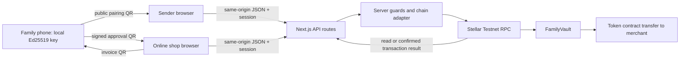

# OpenTab Global: implemented system map

**Release note (two-mode release, branch `release/two-mode`):** Product Mode ships as a read-only showcase. Onboarding is role selection only (no email/name fields); the dashboard shows live Family #7 data and its money/pairing actions open Demo Mode. The fuller backend-integration attempt is preserved on branch `feat/product-backend-integration`.

**Frontend route update:** [ONBOARDING_FRONTEND.md](ONBOARDING_FRONTEND.md) describes the new local-only home/setup preview and `/demo/*` aliases. The API, protocol, contract, storage and payment behavior mapped below remains unchanged.

Source review: 2026-11-12. Companion to [UI_REDESIGN_GUIDE.md](UI_REDESIGN_GUIDE.md). This describes repository behavior, not a fresh audit or verification of external deployments. Code references below are relative to the repository root.

## Architecture and authority

The npm workspace contains `apps/web` (Next.js 15.5.29, React 19.1.1, TypeScript) and `packages/shared` (browser-safe protocol and amount math). The root Cargo workspace contains FamilyVault and OfflineChannel, using soroban-sdk 29.0.1. The archive is a separate, unused reference workspace.

There is no application database, production identity service, payout integration, wallet connector, or external live FX service in the current app. React state and localStorage provide browser convenience. Stellar contract state is authoritative for funds and replay records.

This is Mode A. Recipient signing uses no server request. Shop invoice creation is also local, but settlement requires the connected merchant/server. The server signs outer transactions with demo sender/merchant keys; the recipient's separate Ed25519 signature authorizes the exact purchase.

## Source owners

| Responsibility | Source |
|---|---|
| Role UI, handlers, local state | `apps/web/app/{sender,family,shop}/page.tsx` |
| QR/scanner, session UI, fetch helper, error copy | `apps/web/app/components.tsx` |
| HTTP endpoints | `apps/web/app/api/**/route.ts` |
| Auth/CSRF/rate/body limits | `apps/web/lib/guard.server.ts` |
| Soroban arguments, simulation, signing, sending, polling, error translation | `apps/web/lib/chain.server.ts` |
| JSON bigint/bytes conversion, public read limit, family ID validation, recent events | `apps/web/lib/api.server.ts` |
| Public identities, Testnet constants, merchant names, demo rates | `apps/web/lib/config.ts` |
| Static historical transaction evidence | `apps/web/lib/evidence.ts` |
| Canonical signing bytes, keys, QR codecs, amount math, status helper | `packages/shared/src/index.ts` |
| Authoritative family balances, keys, replay protection and payment | `contracts/family_vault/src/lib.rs` |
| Separate both-offline channel contract; no app integration | `contracts/offline_channel/src/lib.rs` |

## API contract

All handlers are dynamic. JSON serialization converts bigint to decimal strings and byte arrays to lowercase hex recursively. Consumers must preserve amounts/IDs as strings or bigint; do not coerce them into floating-point numbers for payment calculations.

| Method/path | Request | Successful response / behavior |
|---|---|---|
| `GET /api/auth/status` | Cookie if present | `{authorized, enabled}`. Public; does not use `readLimited`. |
| `POST /api/auth/login` | `{code}` | `{authorized:true}` and session cookie. Wrong code: `BadCode`. |
| `POST /api/auth/logout` | `{}` | `{authorized:false}` and expired cookie. |
| `POST /api/sender/family` | `{amount}`; default `"20"` if omitted | Create family, then deposit. `{familyId,sender,createTx,depositTx,depositStatus,balance}`; if creation unresolved, `{step:"create_family",hash,status,...}`. |
| `POST /api/sender/deposit` | `{familyId,amount}` | Invoke deposit; `{hash,status,result?,error?,balance}` where balance is the invocation result if available. |
| `POST /api/sender/key` | `{familyId,publicKey,action}` | `action === "revoke"` revokes; otherwise registers. Returns invocation result. |
| `GET /api/family/[id]?key=<hex>` | Family ID; optional public key | `{familyId,family,keyActive?,payments}`. Invalid optional key is ignored; `keyActive` may be omitted/null rather than false. |
| `GET /api/merchant/[id]` | `A` or `B` | `{merchant,balance,payments}`. Balance is merchant token balance, not fiat. |
| `POST /api/merchant/pay` | `{merchantId,authorization,forceSubmitForDemo?}` | `{hash,status,result?,error?,familyBalance}` or a validation/status error. Authorization is the full `OTA1:` string. Demo force flag bypasses only the server's used-invoice precheck, never contract replay protection. |
| `GET /api/tx/[hash]` | 64 lowercase hex hash | `{hash,status,result?,error?}`; polls up to 4 seconds; never resubmits. |
| `GET /api/invoice?family=<id>&id=<hex>` | Family ID and 64 lowercase hex invoice ID | `{used:boolean}` from contract replay record. No transaction hash is returned. |
| `GET /api/preflight` | Cookie optional | `{checkedAt,public,operator,authorized}`; checks contain `{name,ok,detail}`. Operator checks appear only with valid session. |

Common error envelopes use `{error,detail}`; invocation envelopes use `status` and may also contain `error`. Check response fields, not HTTP status alone: some failures intentionally return HTTP 200, including invalid create-family amount and several pay rejections. `api()` in `components.tsx` always attempts JSON and returns `NetworkError` or `BadResponse` objects rather than throwing those cases.

### Validation and access

- Family IDs in HTTP endpoints: strings matching `^\d{1,12}$`; internal contract uses u64.
- Public keys in key endpoint: 64 lowercase hex chars. Invoice/hash status paths likewise require 64 lowercase hex chars.
- Create/deposit amounts: decimal strings, up to seven fractional digits, positive and at most 50 OTUSD. This cap is a web demo limit, not the vault's full contract limit.
- Server signers: `SENDER_SECRET`, `MERCHANT_A_SECRET`, `MERCHANT_B_SECRET`; all server-only. Even public contract reads use the configured sender's account as the simulation source, so they can fail `NOT_CONFIGURED` without `SENDER_SECRET`.
- Mutation guard requires POST, same-origin host match, JSON content type, per-route/IP rate limit, valid demo session where required, and body text length at most 4096. The implementation checks JS string length, despite the constant name `MAX_BODY_BYTES`.
- Session cookie `ot_demo`: HMAC-signed expiration, 8 hours, HttpOnly, SameSite=Strict, Secure in production. Demo access needs code length >=8 and session secret length >=32. Missing configuration disables authenticated mutations.
- Guard limits per minute/IP/path: create family 4, deposit 10, key 10, merchant pay 20. Login has 10/min plus a separate 10/10-minute bucket; login/logout skip session auth but retain same-origin/JSON/body protections.
- Public chain/read endpoints use 120/min/IP. Limits and in-flight locks are process-local best effort. Contract replay protection is the durable authority across server instances.

## Connected payment flow

1. Sender creates a family, then funds it; server invokes both transactions sequentially. The family ID is not an invitation credential.
2. Family generates a 32-byte local Ed25519 secret; pairing exposes only its public key and sanitized label. Sender compares the fingerprint and registers the public key on chain.
3. Shop computes a quote from configured illustrative rates. Invoice contains a random 32-byte ID, public network/vault/token/merchant identities, terminal, token amount, local-price quote and expiry `now + 900 seconds`.
4. Family parses the QR and checks configured vault/token. At approval, shared validation checks positive amount, expiry, maximum 24-hour future window, nonce length and amount/quote agreement. Signature is generated locally.
5. Shop matches invoice ID, amount and merchant to its saved invoice and verifies the recipient signature. This does not establish active key registration, available funds or settlement.
6. Pay endpoint checks network/vault/token, selected merchant, signature, expiry and prior use; creates Soroban `PaymentAuth` and invokes `pay` with the appropriate merchant signer.
7. FamilyVault requires merchant auth, active registered key, positive unexpired payment within the 24-hour maximum, unused `(family_id,invoice_id)`, valid canonical signature and sufficient balance. In one atomic invocation it records use, debits family balance, transfers tokens, increments totals and emits `Paid`.
8. API reports actual transaction result or unresolved status. Shop updates saved checkout and recent history. Family checks invoice-used records when online to mark its local approvals settled.

The server builds Soroban struct keys in sorted order: `amount`, `expires_at`, `family_id`, `invoice_id`, `merchant`, `quote_hash`, `signer`, `terminal_id`. Altering this ABI or rebuilding signed values is outside a visual redesign.

## Canonical bytes and QR formats

Mode A message is exactly **340 bytes**, with big-endian integers. It is locked by `packages/shared/vectors/payment_v1.json`, the TS tests and the Rust cross-language test.

| Offset | Bytes | Value |
|---|---|---|
| 0 | 8 | `OTFV1` followed by three zero bytes |
| 8 | 32 | SHA-256 of Testnet passphrase |
| 40 | 56 | Vault strkey ASCII |
| 96 | 56 | Token strkey ASCII |
| 152 | 8 | Family u64 |
| 160 | 32 | Signer public key |
| 192 | 56 | Merchant strkey ASCII |
| 248 | 4 | Terminal u32 |
| 252 | 32 | Invoice nonce |
| 284 | 16 | Token base-unit amount i128 |
| 300 | 32 | Quote hash |
| 332 | 8 | Expiry u64, Unix seconds |

Quote hash is SHA-256 of UTF-8 `OTQ1|currency|localMinor|minorDigits|rate|source|amount`. The contract receives this hash; it does not fetch FX or independently inspect the local-price text. `merchantName` is display-only and unsigned; the merchant address is signed. Preserve the address display alongside the friendly name.

| Prefix | Payload |
|---|---|
| `OTI1:` | Compact invoice JSON: `n,v,t,m,mn,ti,id,a,e,q`. `n` is `T`; `id` is base64url; amount/expiry/local minor amount are decimal strings; quote tuple is `[currency,localMinor,minorDigits,rate,source]`. |
| `OTA1:` | JSON `{i,f,k,s}`: embedded invoice, family ID string, base64url public key, base64url 64-byte signature. |
| `OTK1:` | `OTK1:<64 lowercase hex public key>:<sanitized label>`. Label generation permits word chars, spaces, hyphens, maximum 40 chars. |

Do not replace these with URLs, reorder a quote tuple, round fields, regenerate a nonce after approval, or serialize bigint directly through JSON. Import existing codecs.

### Amounts

Token amounts use seven decimals; 1 OTUSD = 10,000,000 base units. `computeCharge` uses integer ceiling:

`ceil(localMinor * 10^7 * 10^rateDecimals / (rateScaled * 10^minorDigits))`.

Example: MXN 100.00 / 18.4200 = **5.4288817 OTUSD** (`54288817` units). MXN 20.00 = **1.0857764 OTUSD** (`10857764`). Rates in config: MXN 18.4200, BRL 5.6100, PHP 58.2500, CAD 1.3900, USD 1.0000; all local currencies use two minor digits. Source is `ILLUSTRATIVE`.

`formatTokenAmount` defaults to two digits and truncates; it does not round the authorized charge. The exact-charge review uses seven digits. Keep payment calculations and persisted values independent of any shorter display.

## Checkout statuses and reconciliation

The shared package defines `CREATED`, `PRESENTED`, `AUTHORIZED_LOCALLY`, `SUBMITTED`, `PENDING`, `UNKNOWN`, `CONFIRMED`, `FAILED`, `EXPIRED`, a `transition()` validator and `isPaid()`. **The Shop imports the type but assigns statuses directly; it does not call `transition()`.** Treat the actual Shop handlers as the current behavior.

| Event | Actual Shop behavior |
|---|---|
| Create invoice | `PRESENTED` |
| Match/verify approval | `AUTHORIZED_LOCALLY` |
| Submit | Synchronously locks; checks expiry; saves `SUBMITTED` before request |
| API confirmed/pending/unknown | Maps to the corresponding status |
| Fetch, non-JSON or server error | `UNKNOWN` |
| Unauthorized / rate limited | `AUTHORIZED_LOCALLY`, allowing same approval after access/rate issue resolves |
| Other unsuccessful response | `FAILED` |
| Client expiry before normal submit | `EXPIRED` |
| Pending/unknown reconciliation | Scheduled after 3 seconds; manual check also available |

Server invocation simulates, assembles, signs and computes a hash before sending. A send transport exception returns `UNKNOWN` with hash; network rejection returns `FAILED`. Polling checks every 1.5 seconds for up to 25 seconds, returning `PENDING` if unresolved. A successful simulation alone never establishes settlement.

Reconciliation first queries an existing hash. Confirmed/failed chain result wins. If unresolved, it checks the original family/invoice's used flag. `used:true` establishes settlement for that invoice and can confirm without a known hash. `used:false` with **no hash** returns to `AUTHORIZED_LOCALLY` for retry of the same approval; with a known hash it remains unresolved. Do not create a different invoice as an automatic retry.

## Browser persistence

| localStorage key | Shape and purpose |
|---|---|
| `opentab.sender.families` | JSON string array of created family IDs, selects last on load |
| `opentab.family.sk` | 64 lowercase hex chars, local recipient private key; never send/log/expose |
| `opentab.family.id` | Family number string |
| `opentab.family.name` | Device/person display name |
| `opentab.family.history` | JSON array capped at 20 approvals: `{invoiceId,familyId?,merchant,amount,local,at,status:"AUTHORIZED_LOCALLY",settled?}`; `at` is milliseconds |
| `opentab.shop.current` | JSON `{merchantId,invoiceQR,authQR?,status,hash?,error?}`; restore invoice/merchant after refresh, reconcile pending/unknown |

These are per-origin browser records, with no server sync or recovery. A new domain/origin does not inherit them. Family storage helpers swallow failures; UI state can exist without durable storage. Deleting the phone key removes only the secret-key entry; it does not revoke the chain key or clear history/family ID. Signing timestamps/expiry use seconds; history uses milliseconds.

## PWA and offline shell

`layout.tsx` mounts `SWRegister`; registration runs on HTTPS or `localhost`. Manifest starts at `/family`, scope `/`, standalone. `next.config.ts` gives `/sw.js` no-cache and root scope headers.

Service worker cache is `opentab-v2`. Install precaches `/`, `/family`, `/shop`, `/sender`, `/demo`, manifest and SVG icon. Registration posts loaded same-origin resource URLs for caching. The worker excludes `/api/` entirely, caches static resources, uses network-first navigation and falls back to cached path or `/family`. It does not turn Shop settlement or Sender operations into offline services.

Design must keep offline-critical assets local and available before disconnection. Route changes, new external asset dependencies or remount-driven network fetches can invalidate offline behavior. Existing tests report a WebKit-emulation offline-reload limitation; physical-device support remains a separate check.

## Contract state and functionality not exposed in UI

FamilyVault stores instance config/admin/token/next ID and persistent family, key and used-invoice records. Family is `{sender,balance,total_deposited,total_paid,total_withdrawn}`. Current invariant is `balance = total_deposited - total_paid - total_withdrawn`; there is no `allocated_offline` field or vault allocation function. Persistent writes extend TTL toward 518,400 ledgers, capped at environment max TTL.

Contract entry points: constructor, `create_family`, `deposit`, `register_key`, `revoke_key`, `pay`, `withdraw`, `extend_family_ttl`, `payment_message`, `get_family`, `balance`, `is_key_active`, `is_invoice_used`, `config`. Web routes expose only the subset described above. Admin is stored but is not a general balance-editing authority.

Server contract error map: 1 FamilyNotFound, 2 NonPositiveAmount, 3 KeyNotActive, 4 InvoiceUsed, 5 InvoiceExpired, 6 InvoiceWindowTooLong, 7 InsufficientFunds, 8 KeyAlreadyRegistered, 9 UnsupportedAddress, 10 Overflow. Signature/auth host errors map separately to BadSignature/Unauthorized where recognized.

### Mode B and archive

OfflineChannel is implemented locally, historically recorded as 24 tests passing, but has no deployed ID or UI/API/shared-TS integration. `open` transfers funds directly from an authorized sender; it is not wired to FamilyVault. It binds one merchant/terminal/key, reserved amount and three deadlines. Settlement pays only the increase in cumulative total, bounded by reserve. Minimum settlement grace is two days after acceptance cutoff; refund requires time strictly greater than `refund_after`. Merchant may release early; sender may extend deadlines later and rotate keys, retaining up to three retiring keys for settlement.

Its ticket is a separate **300-byte `OTOC1`** domain (network, contract, token, channel, merchant, terminal, key, cumulative, order). Do not reuse Mode A invoice codecs or expose a working both-offline toggle. A durable merchant acceptance ledger is still missing.

Archive is an older single-shop model, **88-byte `OPENTAB1`** tickets, fee/treasury support, one expiry that stops settlement, and different key rotation. Its JS uses Node Buffer. It is unused by the active app and remains read-only reference.

## Existing caveats to preserve and record separately

These are source observations, not changes requested or fixes performed:

- `SUBMITTED` is persisted before fetch, but automatic reconciliation only handles `PENDING`/`UNKNOWN`. Reload during `SUBMITTED` is not explicitly recovered by current UI.
- `New sale` can clear unresolved local checkout. Clearing browser state cannot cancel a submitted chain transaction.
- A transport/chain failure may have no human-readable `error` in the Shop because mapping is based on specific response fields. `InFlight` maps to pending; server locks are process-local and acquired after async prechecks, so they are not the final duplicate-payment guarantee.
- Recent-payment reads follow a bounded event window (17,000-ledger starting range, 50-event target, at most five pages). Endpoint catches event errors as `[]`; empty history does not prove no payments occurred.
- Family approval history is not a chain balance ledger. It may contain repeated local approvals; status remains `AUTHORIZED_LOCALLY` with optional `settled:true` enrichment.
- Friendly merchant name and device label are display metadata. Local signature verification alone does not prove that the key is active or balance sufficient.
- No automated browser coverage comprehensively exercises pending/unknown recovery, storage loss or every failure state. Source inspection is not proof those paths work on physical devices.
- Existing planning documents contain stale claims: `/recipient`/`/merchant`, IndexedDB, one-hour invoice windows, incomplete canonical layout, `allocated_offline`, and “nothing deployed.” Current code uses `/family`/`/shop`, localStorage, 15-minute issuance/24-hour validation and the 340-byte layout above. Consult release evidence for historical deployment claims; do not implement stale plans during styling.
- Root `smoke:pay` references missing `scripts/smoke-pay.mjs`. No replacement script was added here.

## Verification evidence for this review

Read active application/protocol/contract code, tests, configuration, scripts, existing docs, submission sources and archive source. Inspected both npm and Cargo lockfile structures, existing screenshots/icons, and extracted the three submission PDFs' text/page metadata. Dependency contents, Git internals, local IDE state and secrets are outside source review scope.

Ran `npm test`: 1 test file, **13 tests passed**. No fresh contract build/tests, live RPC/deployment verification, API mutation tests or browser/device validation was performed. Source fingerprints were captured before documentation work and compared afterward to establish that application/backend/protocol/contract and other non-documentation tracked content was unchanged, including the pre-existing modified root lockfile.
